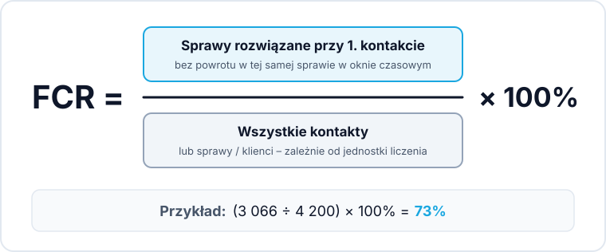
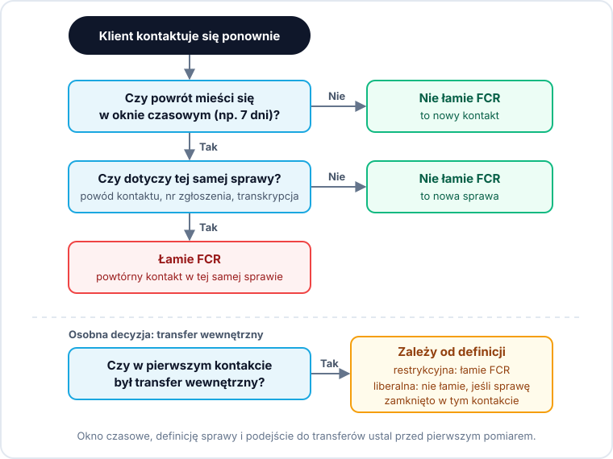

FCR (First Contact Resolution, rozwiązanie przy pierwszym kontakcie) to wskaźnik pokazujący, jaki odsetek zgłoszeń klientów zostaje załatwiony podczas pierwszego kontaktu, bez konieczności ponownego dzwonienia lub pisania w tej samej sprawie. Liczy się go wzorem: FCR = (liczba spraw rozwiązanych przy pierwszym kontakcie / łączna liczba kontaktów) × 100%. Największą trudnością nie jest sam wzór, lecz ustalenie, co dokładnie uznajemy za rozwiązanie i w jakim oknie czasowym sprawdzamy powrót klienta – od tych decyzji zależy, czy wynik będzie porównywalny między miesiącami.

> **W skrócie:**
> * **Wzór:** FCR = (sprawy rozwiązane za 1. razem / wszystkie kontakty) × 100%
> * **Przed pomiarem ustal cztery rzeczy:** okno czasowe, definicję „tej samej sprawy”, traktowanie transferów wewnętrznych oraz jednostkę liczenia.
> * **Cztery metody pomiaru:** ankieta po kontakcie, oznaczenie przez agenta, analiza powtórnych kontaktów w danych oraz analiza treści rozmów. Każda ma inny błąd systematyczny.
> * **Prostszy punkt startu:** warto zacząć od mierzenia odwrotności FCR, czyli *repeat contact rate* obliczanego na twardych danych.
> * **FCR i AHT ciągną w przeciwnych kierunkach:** wyśrubowane cele skracania czasu rozmowy obniżają rozwiązywalność spraw za pierwszym razem.

---

## Czym jest FCR i co naprawdę mówi o Twoim call center?

FCR pokazuje, czy zespół potrafi zamknąć temat klienta w ramach jednej interakcji – telefonicznej, mailowej lub na czacie.

### First contact resolution a first call resolution – czym się różnią
*First call resolution* dotyczy wyłącznie połączeń telefonicznych. *First contact resolution* to pojęcie szersze, dostosowane do obsługi wielokanałowej (*omnichannel*): obejmuje także e-mail, czat, aplikacje mobilne i media społecznościowe. W praktyce oba terminy bywają używane zamiennie.

### Dlaczego FCR jest wskaźnikiem perspektywy klienta, a nie wydajności
Większość metryk contact center mierzy wewnętrzną wydajność: ile połączeń odebrał konsultant, jak szybko rozładowano kolejkę. FCR też liczy się z danych operacyjnych, ale jako jeden z niewielu wskaźników patrzy na proces oczami klienta. Dla klienta ponowny kontakt w tej samej sprawie to główne źródło frustracji, a dla firmy – zbędny koszt. Wysoki FCR oznacza więc jednocześnie oszczędność i wyższą satysfakcję.

## Jak liczyć FCR: wzór i przykład

Sam wzór jest prosty – trudność polega na uczciwym wyodrębnieniu spraw faktycznie zamkniętych.

### Wzór na FCR

> **FCR = (liczba spraw rozwiązanych przy pierwszym kontakcie ÷ łączna liczba kontaktów) × 100%**

### Przykład wyliczenia w praktyce

Dział obsługi odebrał w miesiącu **4 200 kontaktów** we wszystkich kanałach, z czego **3 066** rozwiązano bez ponownego zgłoszenia:

> **FCR = (3 066 ÷ 4 200) × 100% = 73%**

Pozostałe 27% to sprawy niezamknięte za pierwszym razem – w przybliżeniu odpowiada to udziałowi powtórnych kontaktów. W przybliżeniu, bo nie każdy klient z nierozwiązaną sprawą wraca – część po prostu rezygnuje.

### Repeat contact rate jako odwrotność FCR

Wielu menedżerów zaczyna od mierzenia odwrotności FCR, czyli wskaźnika powtórnych kontaktów:

> **Repeat contact rate ≈ 100% − FCR**

Powtórny kontakt to twardy fakt w logach – powrót z tego samego numeru lub nowa wiadomość z tego samego adresu e-mail w określonym czasie. „Rozwiązane” jest oceną, powtórny kontakt nie. Dlatego to uczciwszy punkt wyjścia, choć samo dopasowanie po numerze ma ograniczenia opisane niżej.

## Cztery decyzje przed pierwszym pomiarem FCR

Zanim wprowadzisz FCR do raportów, rozstrzygnij cztery kwestie definicyjne. Bez tego wskaźnik będzie nieporównywalny między miesiącami i podatny na manipulacje. Najczęstsze błędy, które z tego wynikają, opisaliśmy w artykule [jak poprawnie mierzyć FCR w call center](/pl/wiedza/blog/jak-mierzyc-fcr-w-call-center/).

### Okno czasowe: 24 godziny, 3 dni czy 7 dni
Okno określa, przez ile czasu od pierwszego kontaktu powrót klienta uznajemy za kontynuację tej samej sprawy:
* **24–48 godzin:** proste sprawy transakcyjne i e-commerce (status zamówienia, anulowanie dyspozycji).
* **3–7 dni:** usługi abonamentowe, finanse, telekomunikacja – tam, gdzie zmiana w systemie wymaga czasu lub działania po stronie klienta.
* **Zasada:** im dłuższe okno, tym niższy FCR, ale tym uczciwszy pomiar.

### Co oznacza ta sama sprawa
Powtórny kontakt liczy się tylko wtedy, gdy klient wraca w tym samym temacie – powrót z innym problemem nie powinien obniżać FCR. Tę samą sprawę rozpoznaje się po:
* kodzie powodu kontaktu w CRM (*contact reason*),
* identyfikatorze zgłoszenia (*ticket ID*),
* analizie transkrypcji rozmowy (rozpoznanie intencji klienta).

Samo dopasowanie po numerze dzwoniącego i znaczniku czasu bywa zdradliwe: z jednego numeru dzwonią różne osoby z gospodarstwa domowego lub firmy, a ten sam klient może mieć tego samego dnia dwie niezależne sprawy. Numer trzeba więc łączyć z powodem kontaktu.

### Czy transfer wewnętrzny łamie FCR
To zależy od przyjętej definicji – i trzeba ją wybrać świadomie. Podejście restrykcyjne uznaje każdy transfer za złamanie FCR, bo klient czeka na linii i powtarza problem. Podejście liberalne uznaje sprawę za rozwiązaną, jeśli zamknięto ją w ramach jednego kontaktu, nawet po przekierowaniu. Ważniejsza od wyboru jest konsekwencja i osobny pomiar transferów.

### Jednostka liczenia: kontakt, sprawa czy klient
To decyzja o mianowniku wzoru:
* **Per kontakt:** każde połączenie lub wiadomość to osobny rekord – najłatwiej wyciągnąć z centrali.
* **Per sprawa (ticket):** kontakty połączone w jeden wątek – najbardziej realistyczne w kanałach pisemnych.
* **Per klient:** unikalny klient w okresie – głównie przy wąskich bazach B2B.

## Metody pomiaru FCR w praktyce – wady, zalety i ograniczenia

Stosuje się cztery podejścia, a każde jest obciążone innym błędem systematycznym.

### Ankieta po kontakcie – pytanie wprost do klienta
Klient dostaje po obsłudze (SMS, e-mail, IVR) pytanie: *„Czy Twoja sprawa została w pełni rozwiązana?”*.
* **Zaleta:** ocena pochodzi od osoby, której sprawa dotyczyła.
* **Wada:** odpowiada tylko część klientów, a ocena rozwiązania miesza się z oceną decyzji – klient niezadowolony z odmowy odpowie „nie”, nawet jeśli sprawa została zamknięta.
* **Zastosowanie:** uzupełnienie twardych danych. Szerzej w artykule [jak mierzyć jakość obsługi w call center](/pl/wiedza/blog/jak-mierzyc-jakosc-obslugi-call-center/).

### Oznaczenie przez agenta – najtańsza metoda z konfliktem interesu
Konsultant po rozmowie zaznacza w CRM pole *„sprawa rozwiązana za pierwszym razem”*.
* **Zaleta:** najprostsza i najtańsza w każdym systemie.
* **Wada:** konflikt interesu – agent rozliczany z FCR ocenia własną rozmowę.
* **Zastosowanie:** na start, gdy brak innych danych.

### Analiza powtórnych kontaktów w danych telefonii i CRM
Automatyczne wiązanie kontaktów po identyfikatorze klienta (numer telefonu, e-mail, numer klienta, NIP) i znaczniku czasu.
* **Zaleta:** powtórny kontakt to fakt w danych, a nie czyjaś ocena.
* **Wada:** bez kodów powodu kontaktu trudno odróżnić powrót w tej samej sprawie od nowego zgłoszenia.
* **Zastosowanie:** fundament analityki w większych zespołach.

### Analiza treści rozmów i transkrypcji (Speech Analytics)
Automatyczna analiza transkrypcji połączeń i treści wiadomości modelami językowymi (więcej w artykule [AI w call center](/pl/wiedza/ai-w-call-center/)).
* **Zaleta:** powód kontaktu i deklaracja rozwiązania są wykrywane w samej rozmowie, a nie zgadywane z kodu wybranego przez agenta. To rozwiązuje największy problem metody danych – rozpoznanie, czy powrót dotyczy tej samej sprawy.
* **Wada:** wymaga wdrożenia narzędzia, a wynik zależy od jakości transkrypcji i trafności rozpoznania intencji.
* **Zastosowanie:** zespoły z dużym wolumenem rozmów, które automatyzują [kontrolę jakości obsługi](/pl/kontrola-jakosci-obslugi/). Przykładowo InOro.ai analizuje 100% rozmów po ich zakończeniu i pozwala łączyć kontakty w sprawy na podstawie tego, o czym klient faktycznie mówił ([analiza rozmów](/pl/analiza-rozmow/)). Narzędzie dostarcza dane do policzenia FCR – okno czasowe i definicję sprawy nadal ustalasz Ty.

### Zestawienie metod pomiaru FCR

| Metoda pomiaru                 | Obiektywność | Koszt wdrożenia | Główne źródło błędu                | Kiedy stosować                      |
| :----------------------------- | :----------- | :-------------- | :--------------------------------- | :---------------------------------- |
| **Ankieta po kontakcie**       | Średnia      | Niski           | Kto odpowiada, ocena decyzji       | Do weryfikacji percepcji klienta    |
| **Deklaracja agenta**          | Niska        | Bardzo niski    | Konflikt interesu konsultanta      | Na start, przy braku budżetu        |
| **Dane z telefonii i CRM**     | Wysoka       | Średni          | Trudność w rozróżnieniu spraw      | Jako główny wskaźnik operacyjny     |
| **Analiza treści rozmów (AI)** | Wysoka       | Średni          | Jakość transkrypcji i klasyfikacji | Przy dużej skali połączeń i auto-QA |

## Jaki poziom FCR jest dobry? Benchmarki a rzeczywistość

Nie ma jednej dobrej wartości – FCR zależy od branży, złożoności spraw i przyjętych zasad pomiaru.

### Dlaczego sztywne benchmarki międzybranżowe wprowadzają w błąd
Raporty branżowe podają uśrednione wyniki, ale bez informacji o branży, złożoności spraw i sposobie pomiaru taka średnia niewiele mówi. Infolinia sklepu, gdzie większość pytań dotyczy statusu paczki, osiągnie inny poziom niż wsparcie techniczne B2B czy reklamacje w banku.

### Dlaczego FCR zależy od złożoności spraw i zakresu uprawnień agenta
* **Złożoność zgłoszeń:** im więcej prostych spraw przejmuje samoobsługa (reset hasła, boty, FAQ), tym trudniejsze trafiają do konsultantów – FCR spada, choć obsługa jako całość działa lepiej.
* **Uprawnienia agenta (*empowerment*):** jeśli na rabat, zwrot czy decyzję reklamacyjną potrzebna jest zgoda kierownika, FCR pozostanie niski niezależnie od umiejętności zespołu.

### Jak ustalić własny punkt odniesienia
1. Ustal stałe zasady pomiaru (okno, definicja sprawy, transfery).
2. Mierz FCR przez 2–3 miesiące bez zmian w procesach.
3. Rozbij wynik na kategorie spraw (*contact reason*) i linie produktowe.
4. Wyznaczaj cele względem własnej historii, nie średnich rynkowych.

## Dlaczego klienci dzwonią drugi raz? Cztery grupy przyczyn

Poprawa FCR zaczyna się od przyczyn powtórnych kontaktów (*root cause analysis*), a nie od ogólnych haseł. Każda z czterech grup wymaga innego działania.

### Brak uprawnień decyzyjnych u konsultanta
Agent nie rozwiąże sprawy, jeśli procedury mu na to nie pozwalają: ma sztywne limity kwotowe (np. nie może wydać zwrotu nawet do 50 zł), potrzebuje akceptacji przełożonego albo musi przekazać sprawę do drugiej linii (*tier 2*).

### Brak dostępu do informacji i poszatkowane systemy
Konsultant przełącza się między niezintegrowanymi systemami (billing, CRM, magazyn, zgłoszenia). Efekt: niepełne informacje, presja na zakończenie rozmowy przed zebraniem szczegółów i brak wiedzy o wcześniejszych kontaktach klienta w innych kanałach.

### Przyczyny leżące poza działem obsługi
Obsługa przyjmuje skutki błędów innych działów:
* **Logistyka:** opóźnienia, błędnie skompletowane zamówienia.
* **Produkt:** błędy aplikacji, niejasne instrukcje.
* **Billing:** nieczytelne faktury, błędne naliczenia.
* **Marketing:** niedoprecyzowane warunki promocji.

### Przyczyny komunikacyjne i nietrafione założenia
Sprawa jest formalnie zamknięta, ale klient wraca, bo nie zrozumiał rozwiązania, konsultant mówił żargonem albo założył, że klient wie, co zrobić dalej (np. kliknąć link aktywacyjny), i tego nie sprawdził.

Do diagnozy tych przyczyn nie wystarczy ręczny odsłuch losowych 1–2% nagrań. Coraz częściej wykorzystuje się analizę transkrypcji (np. w systemie InOro.ai), która wyciąga powody powtórnych kontaktów z pełnej bazy rozmów i pozwala zadawać o nie pytania w języku naturalnym.

## Jak poprawić FCR: 7 działań naprawczych

Każde z poniższych działań odpowiada jednej z przyczyn powtórnych kontaktów.

1. **Poszerzenie uprawnień decyzyjnych (*empowerment*)**
   Przeanalizuj, które sprawy trafiają do drugiej linii lub wymagają zgody kierownika. Próg decyzyjny dla konsultantów (np. rekompensata do 100 zł bez akceptacji) usuwa całą kategorię spraw, które dziś z definicji nie mogą zostać zamknięte przy pierwszym kontakcie.

2. **Jeden widok klienta (*single customer view*)**
   Połącz historię z CRM, telefonii i systemu zgłoszeń w jednym interfejsie, żeby konsultant od razu widział, o czym klient pisał na czacie dwie godziny wcześniej.

3. **Aktualna baza wiedzy**
   Krótkie, procesowe ściągawki jako jedyne źródło prawdy. Każda zmiana w ofercie lub regulaminie powinna trafić do bazy przed publicznym ogłoszeniem.

4. **Eliminacja powodów kontaktu u źródła**
   Regularnie przekazuj działom produktu, logistyki i marketingu raporty o tym, które procesy i zapisy na stronie generują najwięcej powtórnych zapytań.

5. **Potwierdzenie zrozumienia na końcu rozmowy**
   Zamiast *„Czy mogę w czymś jeszcze pomóc?”* konsultant upewnia się, że klient wie, co stanie się dalej (*„Mail z linkiem przyjdzie w ciągu 15 minut, proszę w niego kliknąć – czy to jasne?”*).

6. **Coaching i auto-QA oparte na realnych powtórnych kontaktach**
   Skup coaching na rozmowach, po których klient zadzwonił ponownie. Auto-QA ze scorecardami pozwala sprawdzić na wszystkich nagraniach, czy konsultanci domykają sprawy i potwierdzają zrozumienie.

7. **Zamknięcie pętli z klientem (*closing the loop*)**
   Jeśli sprawa wymagała analizy wewnętrznej, to firma powinna odezwać się pierwsza po jej rozwiązaniu – zanim klient zadzwoni zapytać o status.

## FCR a inne wskaźniki: na co musisz uważać

Maksymalizowanie FCR w oderwaniu od innych metryk może przynieść odwrotny skutek.

### FCR a AHT – przeciąganie liny
Średni czas obsługi (*AHT, Average Handling Time*) i FCR ciągną w przeciwne strony. Presja na krótkie rozmowy prowadzi do niedomkniętych tematów i powrotów klientów, a dokładne wyjaśnienie sprawy wydłuża AHT. Podobnie działa praca po rozmowie (*ACW, After Call Work*): pominięcie maila z potwierdzeniem czy aktualizacji w CRM skraca ACW, ale klient wraca z niedomkniętą sprawą.

Nie ustawiaj agresywnych celów dla obu wskaźników jednocześnie. Przykładowo: jeśli dodatkowe 30 sekund w pierwszej rozmowie oszczędza drugie, kilkuminutowe połączenie, łączny czas obsługi klienta spada, mimo że AHT pojedynczej rozmowy rośnie.

### FCR a wskaźniki transferów i eskalacji
Wysoki *transfer rate* i *escalation rate* bezpośrednio obniżają FCR. Organizacja, która chce rozwiązywać sprawy przy pierwszym kontakcie, musi przenosić jak najwięcej decyzji na pierwszą linię.

### Czego FCR nie pokazuje – jakość i odczucia klienta
FCR mówi tylko, czy klient wrócił w danym oknie czasowym. Nie mierzy, czy był zadowolony z decyzji (np. odmowy reklamacji), jakie emocje towarzyszyły rozmowie ani czy rozwiązanie było trwałe. Śrubowany pod presją prowadzi do zamykania zgłoszeń na siłę.

Dlatego FCR zawsze należy zestawiać ze wskaźnikami jakościowymi i ocenami satysfakcji. Szerszy kontekst znajdziesz w artykułach [jak mierzyć jakość obsługi w call center](/pl/wiedza/blog/jak-mierzyc-jakosc-obslugi-call-center/) oraz [wskaźniki call center](/pl/wiedza/wskazniki-call-center/). Odczucia klienta mierzą osobne wskaźniki deklaratywne, takie jak CSAT, NPS i CES.

## Często zadawane pytania (FAQ)

### Co to jest FCR?
FCR (*First Contact Resolution*) to wskaźnik pokazujący, jaki procent zgłoszeń klientów udaje się rozwiązać podczas pierwszego kontaktu, bez ponownego dzwonienia, pisania lub czatowania w tej samej sprawie.

### Jak oblicza się FCR?
Liczbę spraw rozwiązanych przy pierwszym kontakcie dzieli się przez łączną liczbę kontaktów w danym okresie i mnoży przez 100%. Przykładowo 3 066 rozwiązanych spraw na 4 200 kontaktów daje FCR 73%.

### Jaki wskaźnik FCR jest dobry?
Nie ma jednej uniwersalnej wartości. Prosta obsługa e-commerce osiągnie wyraźnie wyższy FCR niż wsparcie techniczne B2B czy reklamacje bankowe. Zamiast kopiować benchmarki, mierz FCR przez 2–3 miesiące według stałych zasad i wyznaczaj cele względem własnego wyniku.

### Jak mierzyć FCR w praktyce?
Stosuje się cztery metody: ankietę po kontakcie, oznaczenie przez konsultanta w CRM, analizę powtórnych kontaktów w danych telefonii lub analizę treści rozmów przez AI. Najprościej zacząć od *repeat contact rate* na danych z telefonii i CRM, a potem doprecyzować, które powroty dotyczą tej samej sprawy.

### Czym różni się first call resolution od first contact resolution?
*First call resolution* dotyczy wyłącznie połączeń telefonicznych. *First contact resolution* obejmuje wszystkie kanały: telefon, e-mail, czat, aplikacje i media społecznościowe.

### Czy wysoki FCR zawsze oznacza dobrą obsługę?
Nie. Wysoki FCR może wynikać z presji na konsultantów, którzy zamykają zgłoszenia bez faktycznego rozwiązania. FCR pokazuje tylko, czy klient wrócił, a nie czy był zadowolony – dlatego analizuje się go razem ze wskaźnikami jakości i satysfakcji.

## Chcesz rzetelnie zmierzyć i poprawić FCR w swoim zespole?
Największym wyzwaniem w pomiarze FCR jest rozpoznanie, czy klient wraca w tej samej sprawie. InOro.ai analizuje 100% rozmów po ich zakończeniu i rozpoznaje powód kontaktu w transkrypcji, co pozwala łączyć kontakty w tę samą sprawę – bez ręcznego odsłuchu i bez zgadywania z kodów CRM. Wdrożenie jako nakładka na Twoją obecną telefonię trwa typowo 1–2 tygodnie, a przy dużych organizacjach dłużej: **[Dowiedz się więcej o kontroli jakości z InOro](/pl/kontrola-jakosci-obslugi/)**.
